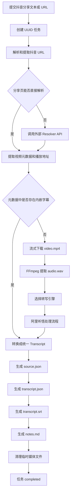
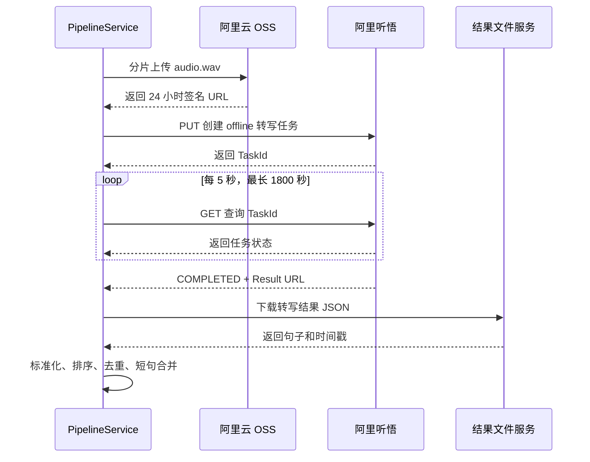

# Douyin Transcribe API 技术栈与听悟处理流程

## 1. 项目定位

`douyin-transcribe-api` 是一个基于 FastAPI 的异步任务服务，用于：

1. 接收抖音分享文本或 URL。
2. 解析抖音视频元数据和播放地址。
3. 优先提取抖音元数据中已有的字幕或视频文本。
4. 在没有内嵌字幕时下载视频并提取音频。
5. 使用阿里听悟或其他转写引擎完成语音识别。
6. 输出 JSON、SRT 和 Markdown 等标准化产物。

## 2. 技术栈

| 层级 | 技术 | 用途 |
| --- | --- | --- |
| 语言与运行环境 | Python 3.11+ | 项目运行环境 |
| Web API | FastAPI、Uvicorn | REST API、OpenAPI 文档及服务运行 |
| 数据模型 | Pydantic | 请求、任务、视频、字幕和产物模型 |
| 配置管理 | pydantic-settings、`.env` | 加载服务和第三方平台配置 |
| HTTP 客户端 | HTTPX | 分享页请求、解析服务调用和媒体下载 |
| HTML 解析 | BeautifulSoup | 提取分享页中的 `RENDER_DATA` 或路由数据 |
| 媒体处理 | FFmpeg | 将视频转换为 16kHz 单声道 WAV 音频 |
| 阿里云存储 | OSS2 | 上传待转写音频并生成签名 URL |
| 阿里听悟 | Aliyun Python SDK | 创建离线转写任务并查询任务状态 |
| 本地语音识别 | faster-whisper、FunASR/SenseVoice | 可选的本地转写引擎 |
| 外部语音识别 | OpenAI-compatible API | 可选的远程转写引擎 |
| 任务存储 | 本地 JSON 文件 | 保存任务状态、进度、错误和产物清单 |
| 测试与检查 | Pytest、pytest-asyncio、respx、Ruff | 单元测试、异步测试、HTTP Mock 和代码检查 |

## 3. API 与数据模型

### 3.1 创建任务

```http
POST /api/v1/tasks/transcribe
Content-Type: application/json
```

```json
{
  "input": "https://v.douyin.com/example/",
  "engine": "tingwu",
  "formats": ["json", "srt", "markdown"],
  "keep_video": false
}
```

接口返回 HTTP `202 Accepted`。服务创建 UUID 任务，将初始记录写入
`data/tasks/<task-id>/task.json`，然后在当前 FastAPI 进程中通过
`asyncio.create_task()` 启动处理流程。

### 3.2 查询与重试

| 接口 | 用途 |
| --- | --- |
| `GET /api/v1/tasks/{task_id}` | 查询状态、进度和错误信息 |
| `POST /api/v1/tasks/{task_id}/retry` | 重置并重新执行失败或已存在的任务 |
| `GET /api/v1/tasks/{task_id}/artifacts` | 获取产物清单 |
| `GET /api/v1/tasks/{task_id}/artifacts/{name}` | 下载指定产物 |
| `GET /health/live` | 进程存活检查 |
| `GET /health/ready` | FFmpeg 和转写引擎就绪检查 |

### 3.3 任务状态

```text
pending
  -> resolving
  -> downloading
  -> extracting_audio
  -> transcribing
  -> rendering
  -> completed
```

任何阶段发生异常都会进入 `failed`，并将异常文本写入任务的 `error` 字段。

## 4. 总体处理流程



## 5. 抖音解析流程

### 5.1 输入处理

服务使用正则表达式从完整分享文案中提取以下域名的 URL：

- `douyin.com`
- `iesdouyin.com`

因此请求的 `input` 可以是纯 URL，也可以是包含标题、口令和 URL 的完整抖音分享文本。

### 5.2 Resolver 顺序

解析器按照以下顺序尝试：

1. `SharePageResolver`
   - 使用移动端 User-Agent 请求抖音分享页。
   - 解析 `RENDER_DATA` 或 `window._ROUTER_DATA`。
   - 递归查找包含 `video`、`aweme_id`、`desc` 或 `author` 的视频对象。
2. `ApiResolver`
   - 仅在配置 `DOUYIN_RESOLVER_BASE_URL` 时可用。
   - 请求 `<base-url>/api/hybrid/video_data`。
   - 作为分享页直接解析失败后的兜底方案。

解析结果统一为 `VideoInfo`：

- 抖音作品 ID
- 原始分享 URL
- 重定向后的 URL
- 视频播放地址
- 标题与作者
- 封面地址
- 视频时长
- 原始元数据 JSON

## 6. 内嵌字幕短路

下载视频前，服务会递归扫描视频原始元数据，查找字段名中包含以下标记的分支：

```text
caption, subtitle, sub_title, video_text, ocr, asr, transcript
```

如果找到带时间戳的文本，就转换成 `TranscriptSegment`；如果只有全文，则生成一个覆盖整个视频时长的字幕段。

只要成功提取内嵌字幕，流程就会直接进入产物渲染，不再下载视频，也不会调用阿里听悟。即使请求明确指定 `engine=tingwu`，当前实现仍然遵循这个短路规则。

## 7. 视频下载与音频提取

### 7.1 视频下载

媒体下载采用 HTTPX 流式读取：

1. 校验 URL 必须使用 HTTP 或 HTTPS。
2. 拒绝 URL 中直接出现的本地或私有 IP 地址。
3. 添加抖音 `Referer` 请求头。
4. 检查 `Content-Length`。
5. 下载过程中持续累计字节数。
6. 超过 `MAX_DOWNLOAD_BYTES` 时立即终止。
7. 先写入 `video.mp4.part`，成功后原子替换为 `video.mp4`。

默认最大下载量为 500MB。

### 7.2 音频提取

FFmpeg 查找顺序：

1. `FFMPEG_PATH` 指定的文件。
2. 系统 `PATH` 中的 `ffmpeg`。
3. 项目目录 `.tools/ffmpeg/bin/ffmpeg.exe`。

转换参数：

```text
-vn       移除视频流
-ac 1     转换成单声道
-ar 16000 转换成 16kHz 采样率
```

最终生成适合语音识别的 `audio.wav`。

## 8. 阿里听悟处理流程



### 8.1 上传 OSS

音频通过 `oss2.resumable_upload()` 上传，分片大小为 4MB。对象键格式为：

```text
<ALIYUN_OSS_PREFIX>/<unix-timestamp>-audio.wav
```

上传完成后生成有效期 24 小时的 GET 签名 URL，供听悟读取。

### 8.2 创建听悟任务

请求参数：

```text
Domain: tingwu.cn-beijing.aliyuncs.com
Version: 2023-09-30
Method: PUT
Path: /openapi/tingwu/v2/tasks
Query: type=offline
```

核心请求体：

```json
{
  "AppKey": "<TINGWU_APP_KEY>",
  "Input": {
    "SourceLanguage": "cn",
    "FileUrl": "<OSS signed URL>"
  },
  "Parameters": {
    "Transcription": {
      "DiarizationEnabled": false
    }
  }
}
```

当前实现关闭了说话人分离。

### 8.3 轮询任务

服务通过以下请求查询任务：

```text
GET /openapi/tingwu/v2/tasks/<TaskId>
```

默认行为：

- 每 5 秒查询一次。
- 最长等待 1800 秒。
- `COMPLETED`、`SUCCESS` 或 `SUCCEEDED` 视为成功。
- `FAILED` 或 `ERROR` 立即终止并记录错误。
- 成功后读取结果 URL，再下载实际的转写 JSON。

### 8.4 结果标准化

听悟结果会转换成项目统一的 `Transcript`：

```json
{
  "engine": "tingwu",
  "language": null,
  "text": "完整转写文本",
  "segments": [
    {
      "start_ms": 0,
      "end_ms": 3200,
      "text": "第一段字幕"
    }
  ]
}
```

标准化步骤：

1. 递归查找文本和开始、结束时间字段。
2. 将时间统一转换为毫秒。
3. 按开始时间排序。
4. 根据时间范围和文本去重。
5. 当结果中短句比例较高时合并连续短句。
6. 根据标点、持续时间或文本长度决定何时结束一个合并段。

## 9. 产物目录

任务产物位于：

```text
data/tasks/<task-id>/
```

| 文件 | 内容 |
| --- | --- |
| `task.json` | 请求、状态、进度、错误和产物清单 |
| `source.json` | 抖音视频的标准化信息和原始元数据 |
| `transcript.json` | 标准化全文及分段时间轴 |
| `transcript.srt` | 标准 SRT 字幕 |
| `notes.md` | 包含来源信息和全文的 Markdown 笔记 |
| `video.mp4` | 仅在 `keep_video=true` 时保留 |

`audio.wav` 在任务完成后删除；`keep_video=false` 时，下载的视频也会被删除。

## 10. 关键配置

```env
TRANSCRIBE_ENGINE=tingwu

ALIYUN_ACCESS_KEY_ID=...
ALIYUN_ACCESS_KEY_SECRET=...
ALIYUN_OSS_BUCKET=...
ALIYUN_OSS_ENDPOINT=https://oss-cn-beijing.aliyuncs.com
ALIYUN_OSS_PREFIX=douyin-transcribe

TINGWU_APP_KEY=...
TINGWU_REGION=cn-beijing
TINGWU_LANGUAGE_HINT=cn
TINGWU_POLL_INTERVAL_SECONDS=5
TINGWU_TIMEOUT_SECONDS=1800
```

不要将真实 AccessKey 提交到 Git 仓库。

## 11. 当前限制与注意事项

### 11.1 内嵌字幕优先级

发现内嵌字幕时不会调用听悟。若业务要求所有视频都必须由听悟重新识别，需要增加类似 `prefer_embedded_subtitles` 的配置，并在流水线中允许关闭短路。

### 11.2 OSS 文件生命周期

当前代码上传音频后没有删除 OSS 对象。应配置 OSS 生命周期规则，或在听悟任务成功、失败和超时后主动删除对象，避免长期存储敏感音频和产生额外费用。

### 11.3 Region 与 Domain

SDK 客户端使用可配置的 `TINGWU_REGION`，但听悟请求域名固定为北京区域。切换区域时必须同时调整请求域名，否则可能出现签名、路由或服务不可用问题。

### 11.4 任务可靠性

后台任务运行在 FastAPI 当前进程中：

- 进程重启后，未完成任务不会自动恢复。
- 多进程 Uvicorn 无法共享内存中的运行任务集合。
- 暂无队列、并发限制和分布式锁。

生产环境建议使用 Redis + ARQ、Celery、RQ 或其他持久化任务队列。

### 11.5 Mock 引擎隔离

Mock 仅用于显式指定 `engine=mock` 的开发和端到端冒烟测试。`auto` 模式会跳过 Mock，避免在真实引擎全部不可用时生成模拟文本并错误地将任务标记为成功。

### 11.6 安全边界

- 当前没有 API 身份认证和租户隔离。
- 当前没有请求频率限制和任务并发限制。
- 媒体 URL 检查只拒绝 URL 中直接出现的私有 IP，没有在 DNS 解析后再次校验地址。
- 错误信息直接写入任务记录，需避免第三方响应泄露凭据或内部信息。
- 签名 URL 有效期为 24 小时，应根据最长任务时长缩短到必要范围。

### 11.7 抖音解析稳定性

抖音分享页结构、字段名和风控策略可能随时变化。应保留外部 Resolver 兜底，并使用真实但脱敏的响应样本建立解析回归测试。

### 11.8 字幕质量

- 内嵌字幕递归扫描可能把 OCR 或视频文字误识别成语音字幕。
- 当前模型没有 `speaker` 字段，且听悟说话人分离关闭。
- 听悟结果字段采用递归兼容解析，建议针对真实结果结构增加严格适配器。
- SRT 输出前应进一步检查时间段重叠、空文本和异常长字幕。

## 12. 关键代码位置

| 模块 | 文件 |
| --- | --- |
| 应用装配 | `src/douyin/main.py` |
| API 路由 | `src/douyin/api/routes.py` |
| 主流水线 | `src/douyin/services/pipeline.py` |
| 分享页解析 | `src/douyin/resolvers/share_page.py` |
| 外部解析 API | `src/douyin/resolvers/api.py` |
| 内嵌字幕 | `src/douyin/services/embedded_subtitles.py` |
| 视频下载和 FFmpeg | `src/douyin/services/media.py` |
| 转写引擎路由 | `src/douyin/transcribers/router.py` |
| 阿里听悟 | `src/douyin/transcribers/tingwu.py` |
| 产物渲染 | `src/douyin/renderers/artifacts.py` |
| 任务存储 | `src/douyin/storage/tasks.py` |
| 数据模型 | `src/douyin/models.py` |
| 配置模型 | `src/douyin/config.py` |
